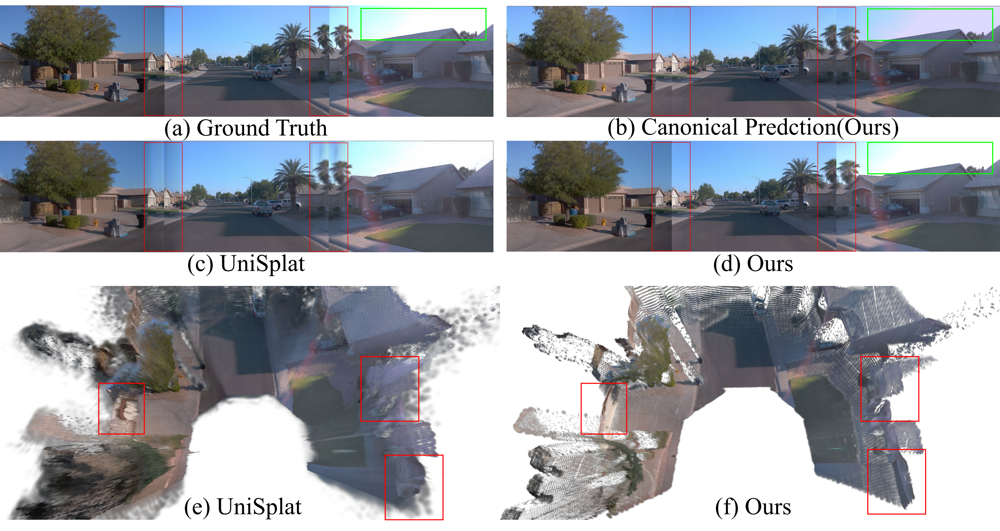
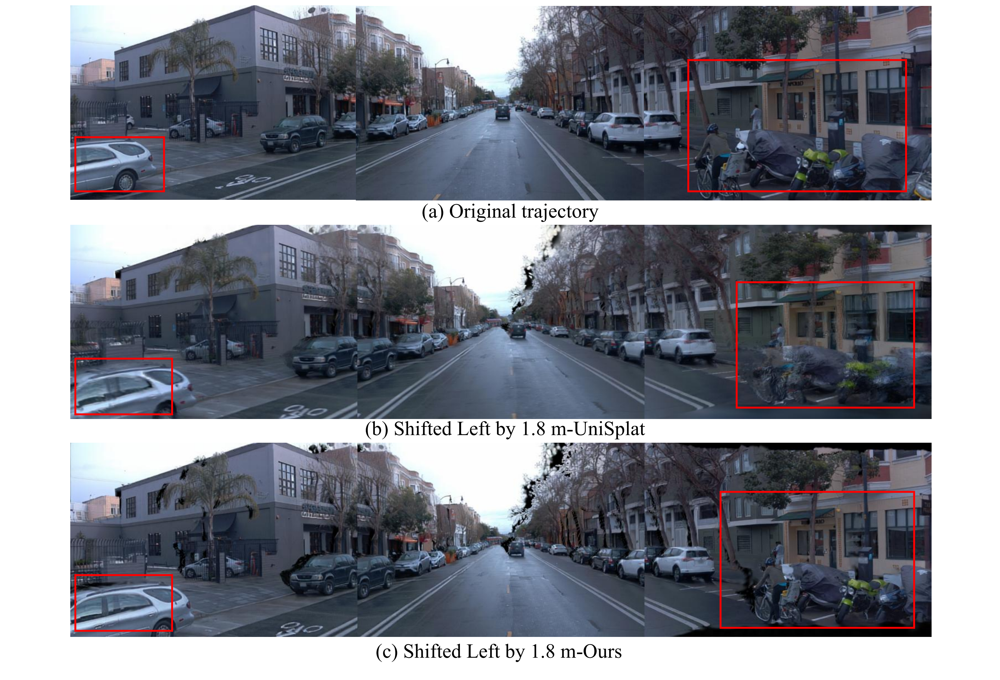

# MCSplat: Multi-View Photometric and Geometric Consistent Feed-Forward Gaussian Splatting for Driving Scenes

<p align="center">
  📑 <a href="https://arxiv.org/abs/2610.25345">Paper (arXiv)</a>
  &nbsp;&nbsp;|&nbsp;&nbsp;
  🌐 <a href="https://yfwang0824.github.io/mcsplat-project/">Project Page</a>
  &nbsp;&nbsp;|&nbsp;&nbsp;
  🤗 <a href="https://huggingface.co/Yifeifei/MCSplat/tree/main">Hugging Face</a>
</p>

MCSplat is a feed-forward Gaussian splatting framework that reconstructs geometrically consistent driving scenes from sparse multi-view images by disentangling camera-dependent appearance from shared geometry and introducing uncertainty-aware geometric self-supervision.

<p align="center">
  
</p>

<p align="center">
  
</p>

## Contents

- [1. Conda environment](#1-conda-environment)
- [2. Download pretrained weights](#2-download-pretrained-weights)
- [3. Prepare the data](#3-prepare-the-data)
- [4. Waymo inference](#4-waymo-inference)
- [5. nuScenes inference](#5-nuscenes-inference)
- [6. Options and validation](#6-options-and-validation)
- [Code layout](#code-layout)
- [Acknowledgement](#acknowledgement)

## 1. Conda environment

Recommended environment: **Linux, Python 3.10, PyTorch 2.4.0, and CUDA 12.1**, with a compatible GPU driver, `nvcc`, and GCC/G++ 11 or 12.

From the repository root:

```bash
git clone https://github.com/yfwang0824/MCSplat.git
cd MCSplat

conda env create -f environment.yml
conda activate mcsplat

export CUDA_HOME="$CONDA_PREFIX"
export PATH="$CUDA_HOME/bin:$PATH"
export MAX_JOBS=4

# Install matching PyTorch and attention wheels.
python -m pip install torch==2.4.0 torchvision==0.19.0 \
  --index-url https://download.pytorch.org/whl/cu121
python -m pip install xformers==0.0.27.post2 --no-deps \
  --index-url https://download.pytorch.org/whl/cu121

python -m pip install -r requirements.txt
python -m pip install 'spconv-cu120>=2.3,<2.4'

# Build/install the repository's nearest-neighbor extension.
# Official gsplat 1.5.3 is installed by requirements.txt.
python -m pip install --no-build-isolation --no-deps ./submodules/simple-knn-v2

```

### External Pi3 dependencies

The Pi3 backbone and Gaussian head require `RoPE2D`, `PositionGetter` and `CameraHead`. These modules are provided by an **external Pi3 dependency**. Download the required source files and upstream licenses to a directory outside MCSplat:

```bash
export MCSPLAT_PI3_ROOT="$HOME/.cache/mcsplat-deps/Pi3"
mkdir -p "$MCSPLAT_PI3_ROOT/pi3/models/layers"

# Pin the upstream revision for reproducible inference.
curl --fail --location --retry 3 \
  https://raw.githubusercontent.com/yyfz/Pi3/9fa3ddb3f8d53041f8b2738df404f62223bbaa7b/pi3/models/layers/pos_embed.py \
  --output "$MCSPLAT_PI3_ROOT/pi3/models/layers/pos_embed.py"
curl --fail --location --retry 3 \
  https://raw.githubusercontent.com/yyfz/Pi3/9fa3ddb3f8d53041f8b2738df404f62223bbaa7b/pi3/models/layers/camera_head.py \
  --output "$MCSPLAT_PI3_ROOT/pi3/models/layers/camera_head.py"
curl --fail --location --retry 3 \
  https://raw.githubusercontent.com/yyfz/Pi3/9fa3ddb3f8d53041f8b2738df404f62223bbaa7b/LICENSE \
  --output "$MCSPLAT_PI3_ROOT/LICENSE"
curl --fail --location --retry 3 \
  https://raw.githubusercontent.com/nianticlabs/marepo/9a45e2bb07e5bb8cb997620088d352b439b13e0e/LICENSE \
  --output "$MCSPLAT_PI3_ROOT/MAREPO-LICENSE"
```

Set `MCSPLAT_PI3_ROOT` in each inference shell, or add that export to your Conda environment's activation script. It may also point to an existing compatible Pi3 checkout. Only these two modules are imported; the upstream repository's other dependencies and pretrained weights are not required.

The validated installation uses Pi3's PyTorch RoPE fallback. **cuRoPE is optional** and is not bundled or required by these inference commands. Its upstream build instructions are available in [CroCo](https://github.com/naver/croco#preparation); a native extension must support your accelerator, tensor layout and precision before it can replace the fallback.

The external [Pi3 positional-encoding source](https://github.com/yyfz/Pi3/blob/9fa3ddb3f8d53041f8b2738df404f62223bbaa7b/pi3/models/layers/pos_embed.py) declares **CC BY-NC-SA 4.0**. It retains its file-specific license; downloading it separately does not remove its upstream usage conditions.

The external camera head attributes its residual block to [MAREPO](https://github.com/nianticlabs/marepo/blob/9a45e2bb07e5bb8cb997620088d352b439b13e0e/transformer/transformer.py). MAREPO's upstream license has noncommercial-use and redistribution restrictions; consult the downloaded `MAREPO-LICENSE` before use. These upstream modules are not relicensed by this repository.

Check the environment:

```bash
nvcc --version
python -c "import torch; print(torch.__version__, torch.version.cuda); assert torch.cuda.is_available()"
python -c "import torch, spconv.pytorch, xformers; from simple_knn_v2._C import distCUDACross; import gsplat; assert gsplat.__version__ == '1.5.3'; print('gsplat', gsplat.__version__)"
python -c "from utils.pi3_dependency import RoPE2D, PositionGetter, CameraHead; print('External Pi3 dependencies are available')"
```

Rendering uses the **official `gsplat==1.5.3`** package installed from PyPI. The released inference path renders synchronized camera views using the standard rasterization API; it does not require a separate local rasterizer checkout. If PyTorch or CUDA is changed, rebuild the extensions against the new environment. PyTorch's supported version combinations are documented [here](https://pytorch.org/get-started/previous-versions/), and spconv installation options are documented [here](https://github.com/traveller59/spconv#install).

For vendor accelerators such as PPU, keep the vendor's compatible PyTorch, torchvision, xformers and spconv packages and build the local extensions with that vendor's toolkit. The NVIDIA wheel commands above are for a separate NVIDIA environment.

## 2. Download pretrained weights

```bash
hf download Yifeifei/MCSplat \
  waymo/model.safetensors nuscenes/model.safetensors \
  --local-dir checkpoints
```

Expected paths:

```text
checkpoints/
├── waymo/model.safetensors
└── nuscenes/model.safetensors
```

Each checkpoint is approximately 4.58 GB and includes the Pi3 backbone, Gaussian head and bilateral-grid transformer. Separate Pi3 or DINO checkpoint downloads are not required. Use the checkpoint corresponding to the dataset: their color-correction configurations differ. A checkpoint outside this directory can be selected with `--checkpoint /path/to/model.safetensors`.

## 3. Prepare the data

Inference consumes the project's **preprocessed scene format**, including synchronized RGB views, camera calibration, sparse camera-space depth, non-sky masks and dynamic-object annotations. Raw Waymo TFRecords and the original nuScenes directory are not read directly. This inference release does not contain the raw-dataset conversion pipeline.

Pass a root whose immediate subdirectories are the scenes to process. All scenes under that root are used unless `--scene-ids` is specified; the loader does not make a train/validation split.

```text
DATA_ROOT/
└── 000/                             # scene directory ID
    ├── images/
    │   ├── 000000_0.png             # frame 000000, zero-based camera 0
    │   ├── 000000_1.png
    │   └── ...
    ├── 00000_1.npz                  # calibration; one-based camera 1
    ├── 00000_1.exr                  # sparse depth in meters
    ├── 00000_1_moge_mask.png         # nonzero = non-sky
    ├── ...
    └── dynamics/
        ├── dynamic_infos.json
        ├── dynamic_mask_0_1.npz      # integer frame ID, one-based camera
        └── ...
```

For image frame string `F` (for example `000000`) and zero-based camera `c`, the exact filenames are:

| Content | Relative path inside a scene |
| --- | --- |
| RGB image | `images/{F}_{c}.png` |
| Calibration | `{F[1:]}_{c+1}.npz` |
| Sparse depth | `{F[1:]}_{c+1}.exr` |
| Non-sky mask | `{F[1:]}_{c+1}_moge_mask.png` |
| Dynamic-instance mask | `dynamics/dynamic_mask_{int(F)}_{c+1}.npz` |

Calibration archives must contain `intrinsics` (3×3), `cam2lidar` (4×4 camera-to-LiDAR transform) and `cam2world` (4×4 camera-to-world transform). Dynamic-mask archives contain the instance-ID image under `data`. `dynamic_infos.json` stores speeds under `track_id_infos[str(int(F))][str(c+1)][track_id]["speed"]`; mask IDs follow `int(hashlib.md5(str(track_id).encode("utf-8")).hexdigest(), 16) % 65535 + 1`. Instances with speed norm below 0.2 are treated as static. Keep this naming and calibration convention when using an existing preprocessed dataset.

Camera conventions and released resolutions:

| Dataset | Camera IDs | Input size (width × height) | Render size |
| --- | --- | --- | --- |
| Waymo | `0=front`, `1=front left`, `2=front right`, `3=side left`, `4=side right` | 518 × 350 | 518 × 350 |
| nuScenes | `0=front`, `1=front left`, `2=front right`, `3=back left`, `4=back right`, `5=back` | 406 × 224 | 400 × 224 |

The loader resizes each camera image independently and updates the intrinsics and sparse-depth projections. The released Waymo configuration does not pad the side-camera images. OpenEXR reading is enabled by the inference entry point.

## 4. Waymo inference

```bash
python run_inference.py \
  --dataset waymo \
  --data-path /path/to/preprocessed/waymo/validation \
  --output-dir outputs/waymo
```

Run selected scene directory IDs, or verify one frame first:

```bash
python run_inference.py \
  --dataset waymo \
  --data-path /path/to/preprocessed/waymo/validation \
  --scene-ids 000,001 --resume

python run_inference.py \
  --dataset waymo \
  --data-path /path/to/preprocessed/waymo/validation \
  --scene-ids 000 --max-frames 1 --no-video
```

Each output PNG is a horizontal mosaic in camera order `[3, 1, 0, 2, 4]`:

```text
outputs/waymo/render_current/combined/{scene}/{frame}_5cam.png
outputs/waymo/render_current/combined/{scene}/current_10fps.mp4
```

## 5. nuScenes inference

```bash
python run_inference.py \
  --dataset nuscenes \
  --data-path /path/to/preprocessed/nuscenes/val \
  --output-dir outputs/nuscenes
```

Select scenes or run a single-frame check:

```bash
python run_inference.py \
  --dataset nuscenes \
  --data-path /path/to/preprocessed/nuscenes/val \
  --scene-ids 002,011 --resume

python run_inference.py \
  --dataset nuscenes \
  --data-path /path/to/preprocessed/nuscenes/val \
  --scene-ids 002 --max-frames 1 --no-video
```

Each output PNG is a 2×3 mosaic: top row `[1, 0, 2]`, bottom row `[3, 5, 4]`:

```text
outputs/nuscenes/render_current/combined/{scene}/{frame}_6cam_2x3.png
outputs/nuscenes/render_current/combined/{scene}/current_10fps.mp4
```

## 6. Options and validation

`--check-only` checks the checkpoint metadata and reads one selected frame, including its calibration and masks, without loading the network or requiring a GPU:

```bash
python run_inference.py \
  --dataset waymo \
  --data-path /path/to/preprocessed/waymo/validation \
  --scene-ids 000 --check-only
```

| Option | Meaning |
| --- | --- |
| `--checkpoint PATH` | Override the dataset-specific weight path |
| `--scene-ids ID,ID` | Select actual scene directory IDs; numeric IDs accept leading-zero normalization |
| `--num-workers N` | DataLoader workers, default 4; use 0 for troubleshooting |
| `--max-frames N` | Limit the total number of selected frames |
| `--resume` | Skip existing PNGs and rebuild videos from saved scene PNGs |
| `--no-video` | Save PNGs only |
| `--fps N` | Video playback FPS, default 10; this does not resample input timestamps |
| `--output-dir PATH` | Output root, default `outputs/<dataset>` |

The inference path uses batch size 1 and runs the backbone in mixed precision, followed by the Gaussian head in float32. It preserves the checkpoint's reference cameras `[0, 3, 4]` during bilateral color correction. Outputs contain current-frame RGB renders; training, temporal evaluation and metric computation are outside this release.

## Code layout

```text
run_inference.py         # checkpoint loading and inference entry point
configs/                # Waymo and nuScenes inference settings
dataset/                # current-frame data loading and geometry helpers
model/                  # Gaussian head, photometric correction and rendering
pi3/                    # Pi3 backbone and required DINO/transformer layers
submodules/simple-knn-v2/ # nearest-neighbor CUDA extension
utils/inference.py      # PNG mosaics and scene videos
utils/pi3_dependency.py # loader for external Pi3 modules
```

## Acknowledgement

We thank the authors of [UniSplat](https://github.com/chenshi3/UniSplat), [gsplat](https://github.com/nerfstudio-project/gsplat), [Pi3](https://github.com/yyfz/Pi3), [bilateral-driving](https://github.com/BigCiLeng/bilateral-driving), [MoGe](https://github.com/microsoft/MoGe), and [SAM 3](https://github.com/facebookresearch/sam3) for sharing their code and projects with the community.
